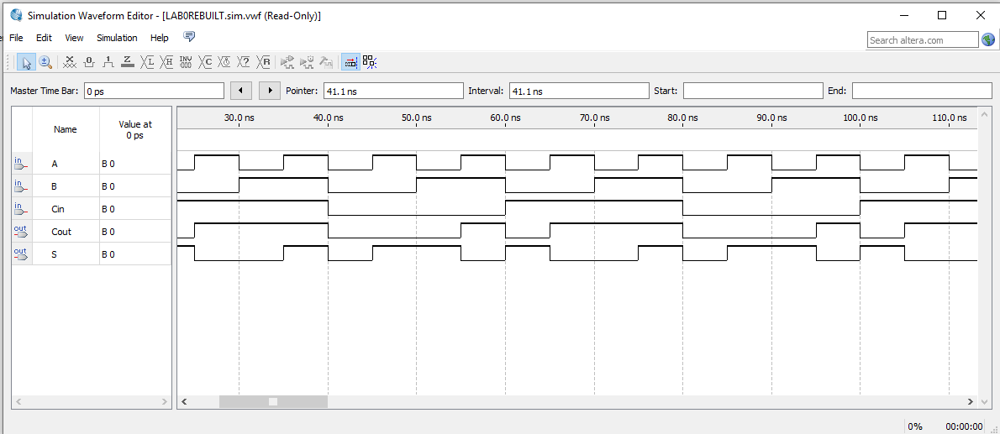
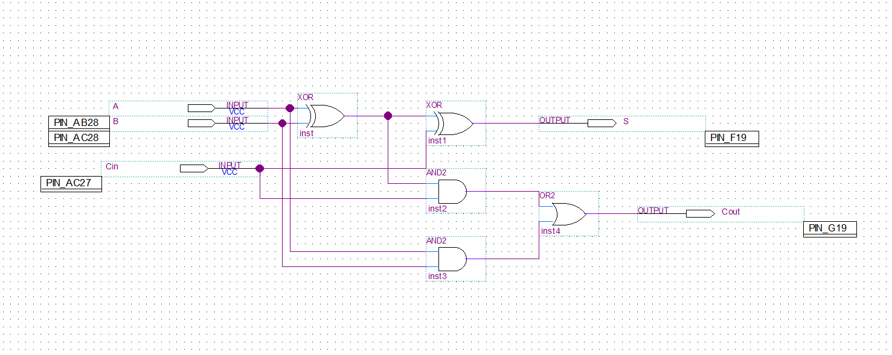
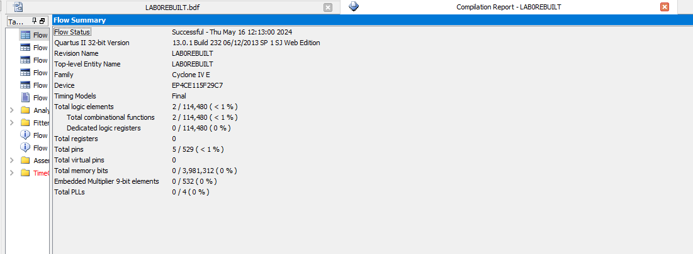

# Lab 0 — Schematic, Simulation and FPGA Verification

This folder contains the visual evidence for **Lab 0: Quartus II Introduction — 1-Bit Full Adder** in CEG2136 (Computer Architecture I).

The design uses three inputs (`A`, `B` and `Cin`) to produce a sum (`S`) and carry-out (`Cout`). The screenshots document its gate-level implementation, Quartus compilation and simulated behavior; the photos show tests on the Terasic DE2-115 FPGA board.

## Files

| File | Description |
| --- | --- |
| [`SCHEMATIC_LAB0.png`](SCHEMATIC_LAB0.png) | Quartus block diagram of the full-adder logic. |
| [`SIMULATION_LAB0.png`](SIMULATION_LAB0.png) | Functional simulation waveforms of the input and output signals. |
| [`COMPILATION_LAB0.png`](COMPILATION_LAB0.png) | Quartus compilation summary. |
| [`IMG_5209.HEIC`](IMG_5209.HEIC) | Photograph documenting an FPGA hardware test. |
| [`IMG_5210.HEIC`](IMG_5210.HEIC) | Photograph documenting an FPGA hardware test. |
| [`IMG_5211.HEIC`](IMG_5211.HEIC) | Photograph documenting an FPGA hardware test. |

## Circuit schematic

## Simulation

## Compilation

## Verification

The lab report documents agreement between the expected and observed sum/carry outputs for all **eight** combinations of the three input bits. The hardware photographs provide examples of the physical verification.

For the Boolean equations, FPGA pin assignments and Quartus source files, see the [Lab 0 overview](../README.md). For the full results and analysis, see the [lab report](../report/).
